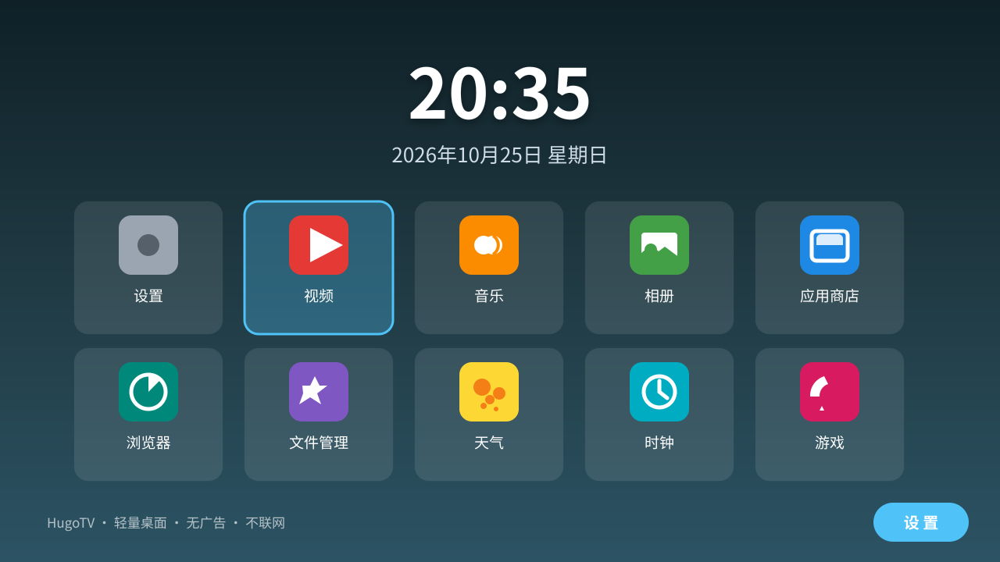
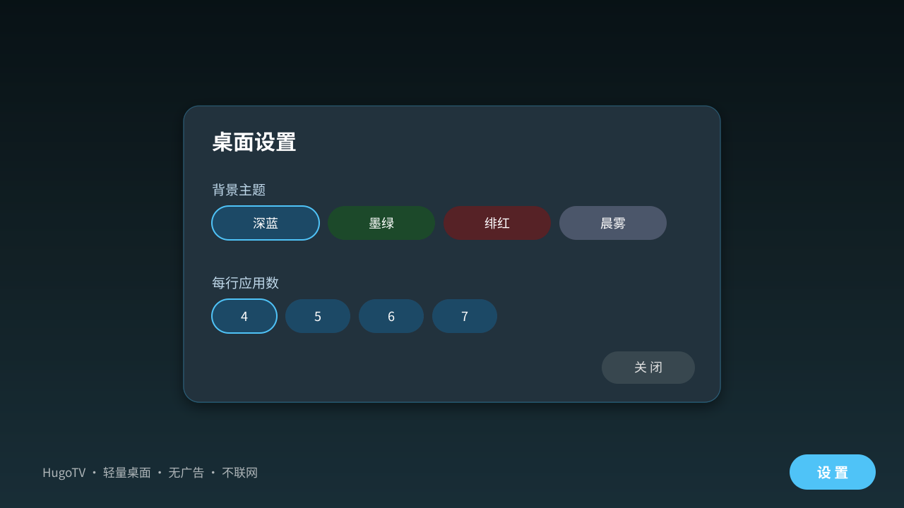
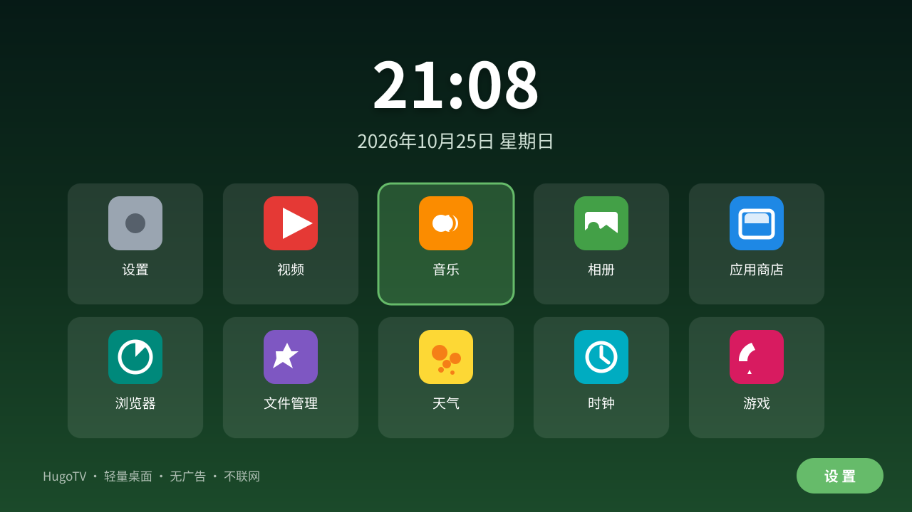

# HugoTV 桌面

> 面向 Android 电视 / 盒子的轻量中文桌面启动器（Launcher）。
> 无广告 · 不联网 · 无后台服务 · 完全本地运行，特别适合已完成系统精简的电视。

HugoTV 是一个从零编写、可完全自托管的 Android TV 桌面：开机即是干净的大时钟 + 应用卡片网格，用遥控器方向键即可完成所有操作。项目不依赖任何第三方库，资源占用极低，适配小米 / 当贝 / 腾讯极光等常见电视盒子。

---

## 特性

| 特性 | 说明 |
|---|---|
| 大时钟 | 顶部实时显示 时:分 与 中文日期（含星期），整机运行零额外权限 |
| 应用卡片网格 | 自动扫描本机已安装应用，按中文拼音排序，图标 + 名称一目了然 |
| 遥控器导航 | 方向键移动焦点、OK 键打开应用，焦点高亮清晰可见 |
| 四套渐变主题 | 深蓝 / 墨绿 / 绯红 / 晨雾，随时切换 |
| 可调列数 | 每行 4–7 个应用，适配不同分辨率（720p / 1080p / 4K） |
| 隐私友好 | 不申请任何网络权限，无广告、无统计、无后台服务 |
| 极简体积 | 单 Activity + 纯代码 UI，APK 仅约 100KB 级别 |
| 一键构建 | 自带 `build.sh` / `build.ps1` 脚本，无需 Gradle / Android Studio |

## 预览

主界面（深蓝主题，应用卡片 + 焦点高亮）：



设置面板（主题切换 + 列数调整）：



墨绿主题（卡片网格实际聚焦效果）：



## 适用设备

- Android 5.0（API 21）及以上 的电视 / 盒子 / 投影仪；
- 32 位与 64 位设备均可（APK 为纯 Java 通用架构，无 native 库）；
- 已实测：小米电视 4X 55 英寸（Android 6.0.1，armeabi-v7a）。

## 安装

### 方式一：ADB 安装（推荐，需要电脑）

```bash
adb connect <电视IP>:5555
adb install -r dist/HugoTV-0.1.0.apk
```

### 方式二：U 盘安装

将 APK 拷贝到 U 盘，插入电视，用电视自带的「文件管理 / 应用管家」找到并安装（需在设置中允许安装未知来源应用）。

## 设为开机桌面

### 方法 A：电视系统设置（无需电脑）

1. 安装后按「主页键」，系统会弹出「选择主屏幕应用」；
2. 选择 **HugoTV 桌面**，勾选「始终」，按确认；
3. 之后按主页键即回到 HugoTV。

> 小米电视提示：部分固件在设置 → 应用 → 默认应用里可直接修改「桌面」。

### 方法 B：ADB 命令（可脚本化）

```bash
# 查询当前系统默认桌面（验收用）
adb shell "cmd package resolve-activity --brief -a android.intent.action.MAIN -c android.intent.category.HOME"
```

## 卸载与还原

在电视上 设置 → 应用 → HugoTV 桌面 → 卸载即可；卸载后按主页键自动回到原系统桌面。原桌面应用（如小米 PatchWall）在精简时请勿卸载，否则会失去还原入口。

## 常见问题

**Q：按主页键没有弹出选择桌面？**
A：先进入 HugoTV，再按主页键；若仍无反应，用方法 B 检查默认 HOME 组件是否为 `cn.hugotv.launcher/.MainActivity`。

**Q：应用列表里没有显示某个应用？**
A：HugoTV 只显示带有启动入口（MAIN/LAUNCHER）的应用；后台服务、桌面插件等不会出现，这是正常行为。

**Q：如何升级？**
A：卸载旧版后安装新版（发布版为 CI 临时签名密钥），或使用 `adb install -r`（若签名一致可直接覆盖）。

## 从源码构建

本项目刻意不依赖 Gradle，构建只需 JDK 17 + Android build-tools 34 + platform-33，脚本会自动下载缺失的工具链。

Windows：

```powershell
powershell -ExecutionPolicy Bypass -File build.ps1
```

Linux / macOS / CI：

```bash
bash build.sh
```

产物：`dist/HugoTV-0.1.0.apk`（已签名，可直接安装）。

> CI 工作流（`.github/workflows/build.yml`）会在每次推送 `main` 分支时自动构建 APK 并发布到 GitHub Release，无需本地构建即可获取最新安装包。

## 系统精简建议

电视越用越卡、开机弹广告，大多是预装应用在后台作祟。参见 [docs/slim-guide.md](docs/slim-guide.md) —— 基于小米电视 4X 实测总结的精简清单，包含：哪些预装可安全移除、每项移除的影响与后果、完整还原命令。

## 目录结构

```
hugotv/
├── AndroidManifest.xml          # 清单（声明 HOME 桌面 + LAUNCHER）
├── src/cn/hugotv/launcher/      # 全部源码（单 Activity，零依赖）
├── res/                         # 图标（矢量）与字符串
├── build.sh / build.ps1         # 一键构建脚本（Windows / Linux / macOS）
├── .github/workflows/build.yml  # CI：自动构建 APK 并发布 Release
├── docs/slim-guide.md           # 电视系统精简建议（实测）
└── preview/                     # SVG 预览图
```

## 技术说明

- `minSdk 21` / `targetSdk 33`，兼容 Android 5.0 起的电视固件；
- 桌面接管通过声明 `CATEGORY_HOME` + `CATEGORY_DEFAULT` 实现，与 Aerial 等开源桌面同一机制；
- 图标为 XML VectorDrawable，无需位图资源；
- 界面全部由 Java 代码构建，无 XML 布局，减少资源层开销。

## License

[Apache License 2.0](LICENSE)

## 声明

本项目为个人开源学习项目，与任何厂商无关。使用本桌面及精简脚本造成的后果由使用者自行承担；动手精简前请务必阅读 `docs/slim-guide.md` 的「重要提醒」，并保留还原入口。
